<p align="center">
  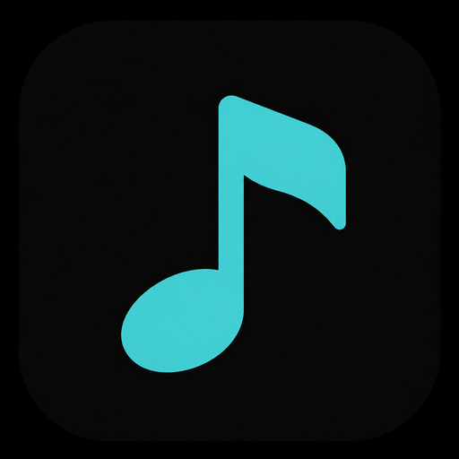
</p>

<h1 align="center">Auralane</h1>

<p align="center"><strong>A desktop YouTube Music client</strong></p>

<p align="center">
  <a href="https://github.com/adam10000423-oss/Auralane/releases/latest"></a>
  <a href="LICENSE"></a>
  <a href="https://github.com/adam10000423-oss/Auralane/releases"></a>
  <a href="https://github.com/adam10000423-oss/Auralane/actions/workflows/release.yml"></a>
</p>

Auralane is a desktop music player for YouTube Music, built with Electron. It combines discovery, queue management, local music, offline playback, synchronized lyrics, translation, desktop lyrics, and compact player experiences in one focused interface.

> Auralane is an independent, unofficial client. It is not affiliated with or endorsed by Google or YouTube.

## What's new in 1.1.0

- **Make the player yours:** Liquid Glass or Standard, light/dark/system appearance, adjustable transparency, and your own image or locally cached video background.
- **Continuous karaoke:** smooth word-level color fill in both Session and full-screen lyrics, custom lyric colors, intro cues, improved backing-vocal presentation and less repaint work during playback.
- **Share the moment:** a live lyric-card editor with selectable lines, three layouts, background/text colors, PNG clipboard copy and download.
- **Keep listening:** rule-based smart playlists, ten replenishing queue recommendations, two-track Crossfade/Automix and a dedicated Replay page.
- **Bring your library:** a Spotify sidebar with persistent single-account sign-in, playlist/liked-song metadata and on-demand YouTube Music matching.
- **Listen Together:** public relay rooms with host-controlled permissions for playback, seeking, adding, reordering and removing songs.
- **Smaller base download:** the optional Windows offline-translation pack is downloaded, verified and removable from Settings instead of bundled into the installer.

See the [detailed 1.1.0 release notes](.github/release-notes/v1.1.0.md) for changes, download choices and limitations.

## Download

| Platform | Package | Notes |
| --- | --- | --- |
| Windows | [Installer (`Setup.exe`)](https://github.com/adam10000423-oss/Auralane/releases/latest) | Recommended. Supports automatic updates. |
| Windows | [Portable (`.exe`)](https://github.com/adam10000423-oss/Auralane/releases/latest) | Runs without installation. |
| macOS Apple silicon | [DMG / ZIP](https://github.com/adam10000423-oss/Auralane/releases/latest) | For M-series Macs. |
| macOS Intel | [DMG / ZIP](https://github.com/adam10000423-oss/Auralane/releases/latest) | For Intel Macs. |

### Which file should I download?

Open the [latest release](https://github.com/adam10000423-oss/Auralane/releases/latest), then choose the file that matches your device:

| Your device | Download this file | When to choose it |
| --- | --- | --- |
| Windows 10 or 11, 64-bit Intel/AMD | `Auralane-Setup-<version>-x64.exe` | Recommended for most Windows users. Installs Auralane and supports one-click automatic updates. |
| Windows 10 or 11, 64-bit Intel/AMD without installation | `Auralane-Portable-<version>-x64.exe` | Runs directly without installing. Settings and app data are still stored on the computer. |
| Mac with an M1, M2, M3, M4, or newer Apple chip | `Auralane-<version>-arm64.dmg` | Recommended Apple silicon installer image. |
| Mac with an Intel processor | `Auralane-<version>-x64.dmg` | Installer image for Intel-based Macs. |
| Apple silicon Mac using a ZIP archive | `Auralane-<version>-arm64.zip` | Alternative to the DMG when you prefer to extract the app manually. |
| Intel Mac using a ZIP archive | `Auralane-<version>-x64.zip` | Alternative to the DMG when you prefer to extract the app manually. |

To identify a Mac, open **Apple menu > About This Mac**. A value such as **Apple M1/M2/M3/M4** under **Chip** means Apple silicon; a value under **Processor** that says **Intel** means you need the x64 build.

On Windows, open **Settings > System > About > System type**. The current Windows release is for **x64-based systems**; Windows on ARM is not currently provided as a native build.

Unsigned macOS builds may require using **Open** from Finder's context menu on first launch. Release files and checksums are published on the [latest release page](https://github.com/adam10000423-oss/Auralane/releases/latest).

## Screenshots

Captured in the running Electron app using live Counting Stars search/lyrics results. Account names and avatars are anonymized. Only the custom-background introduction below enables the rain-window video; other screenshots have video backgrounds disabled. The video is user-selected, not a bundled asset or a hosted video supplied by Auralane.

### Dark Liquid Glass and a custom video background

Clear media in the main area, translucent controls and song rows, a resizable Session panel, and the compact glass transport.

[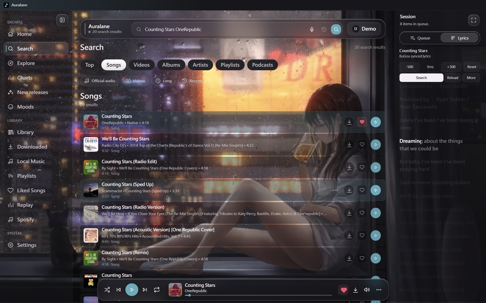](https://raw.githubusercontent.com/adam10000423-oss/Auralane/main/docs/screenshots/15-liquid-glass-demo.mp4)

[Watch the 12-second screen recording (MP4)](https://raw.githubusercontent.com/adam10000423-oss/Auralane/main/docs/screenshots/15-liquid-glass-demo.mp4). Recorded directly from the anonymous Auralane window, without audio; this is not a sequence of screenshots.

### Immersive lyrics

Select Song, Theme, Plain or Custom in the expanded lyrics display controls. Custom retains the configured image/video; changing this selection does not remove your main-window background.

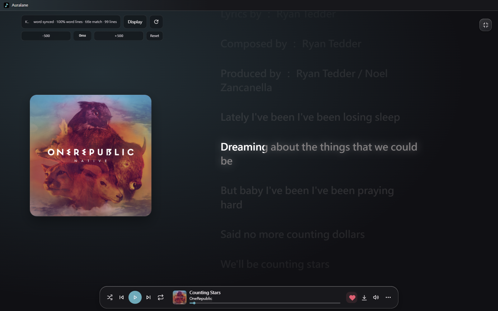

### Live lyric-card editor

Choose up to eight lines, Quote/Square/Poster layout, background and text color. Preview the exported composition before copying the PNG or downloading it.

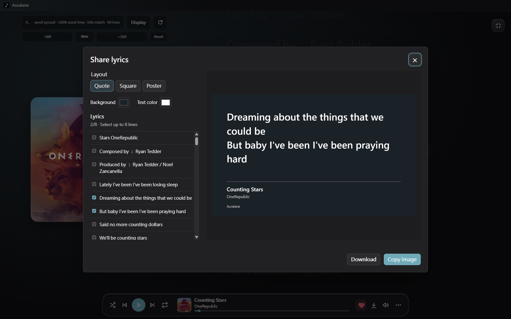

### Standard light appearance

Standard keeps the traditional player layout instead of the compact glass bar. Appearance and accent color are independent choices.

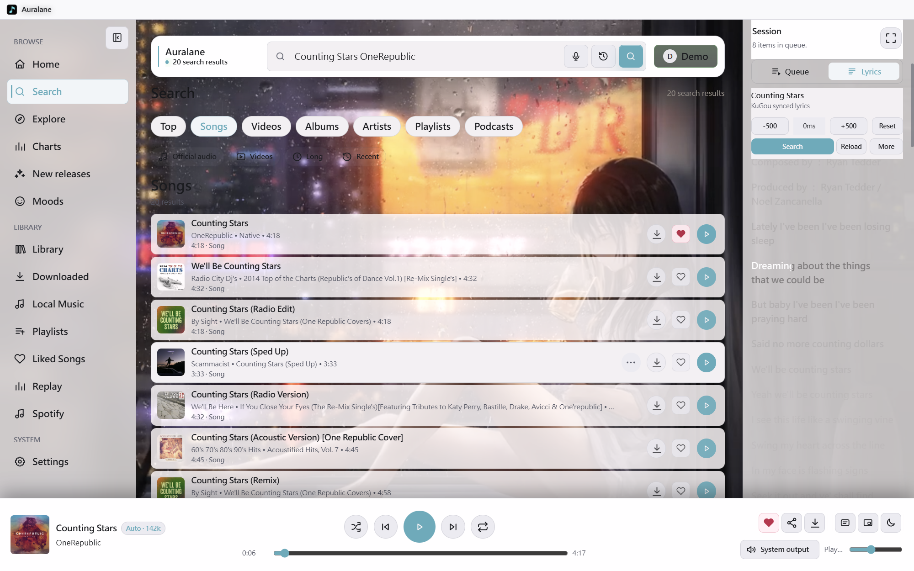

### Appearance settings

Switch material, adjust component transparency, choose light/dark/system appearance, and configure a local image, video or cached YouTube background.

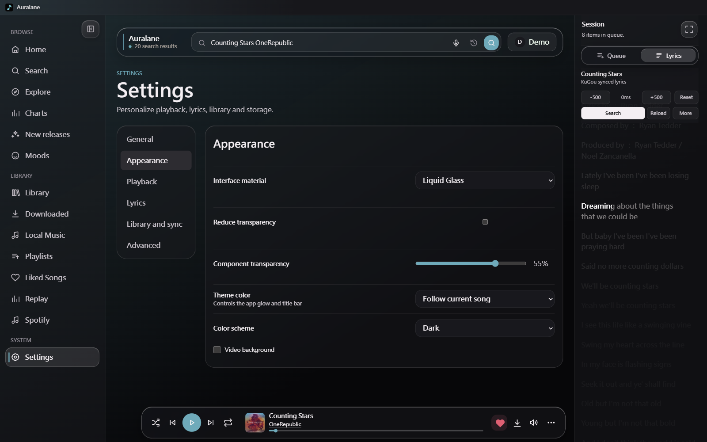

### Home and personal discovery

Browse recommendations, quick picks, recent favorites and mood filters without leaving the original three-pane workspace.

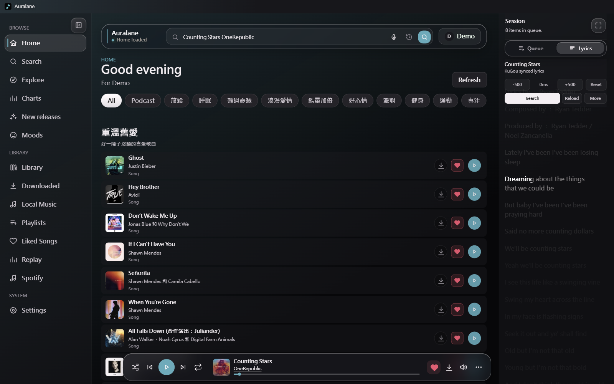

### Library and collections

Switch between playlists, albums, artists, podcasts and liked songs, with search, sorting and direct playback. This screenshot uses public collections as an anonymous demo library, not a private account export.

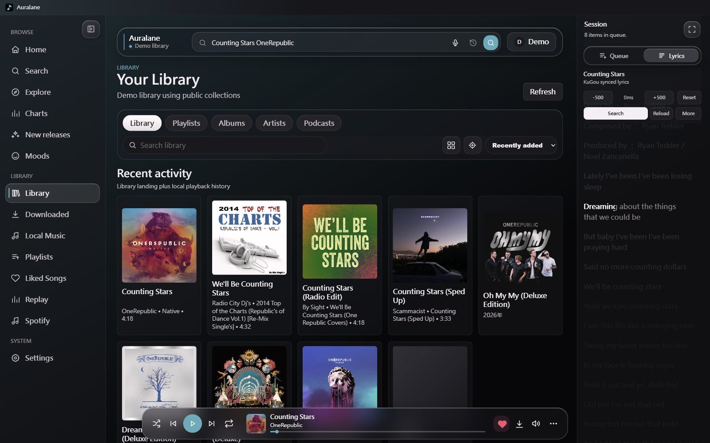

### Artist pages and Session lyrics

Artist biographies, popular songs, related releases, radio and follow controls sit beside Queue or synchronized lyrics.

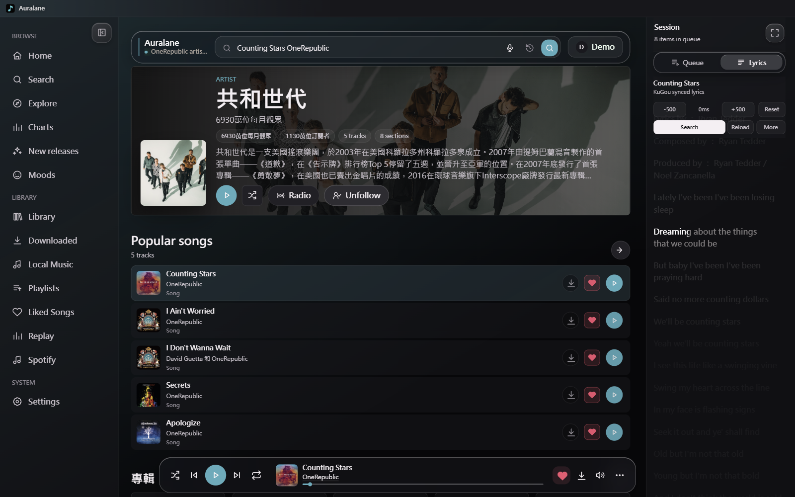

### Mini player and floating desktop lyrics

Keep compact playback controls or synchronized lyrics above other applications. The mini player's external drag handle moves the window without resizing it; desktop lyrics retain their own timing and support translation, word fill, opacity and font settings.

| Mini player | Desktop lyrics |
| --- | --- |
| 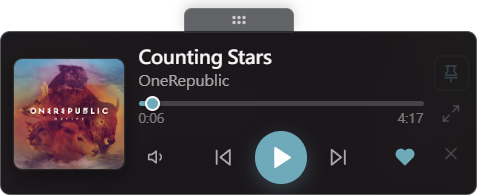 | 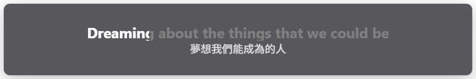 |

### GitHub updates

Review the installed version, check for a release and update from Settings. Startup announcements and sidebar indicators lead to the same controls.

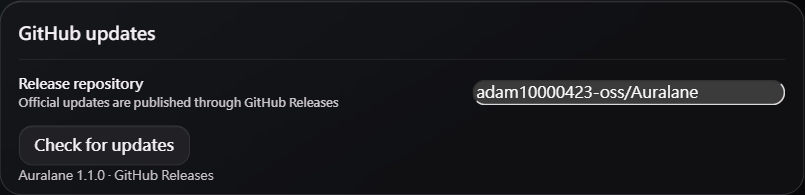

## Features

### Music discovery and playback

- Search songs, videos, albums, artists, playlists, and podcasts.
- Filter search results by media type, official audio, video, duration, and recency.
- Browse Home, Explore, Charts, new releases, moods, and genres.
- Open artist, album, playlist, and podcast pages without leaving the player.
- View artist biographies, popular tracks, related releases, radio, and follow state.
- Direct audio playback with YouTube Music web fallback when required.
- Play, pause, seek, skip, shuffle, repeat, start radio, and restore the previous playback session.
- Queue reordering with drag preview and edge auto-scroll, plus play next, add to queue, and queue lock.
- Playback quality selection, output-device selection, crossfade, gapless playback, ReplayGain, and silence skipping.
- Configurable audio equalizer and output-device switching.
- Media keys, system tray controls, global shortcuts, notifications, and a sleep timer.
- Theme colors can follow the current song artwork.
- Ten clearly separated recommendations are prepared for a new queue and replenished as tracks are consumed or removed; moving one into the main queue promotes it to a normal queue entry.
- Transition modes: Off, equal-power two-track Crossfade, and conservative beat-aligned Automix. Unsupported or uncertain analysis falls back to Crossfade rather than blocking playback.

### Lyrics

- Plain, line-synchronized, and word-synchronized karaoke lyrics.
- Lyrics adapters include NetEase Music, Musixmatch, BetterLyrics, LRCLIB, KuGou, Paxsenix, LyricsPlus, Lyrics.ovh, YouTube transcripts, lrc.red, BiniLyrics, Unison, Betterlyrics Portato and Genius. Availability and timing precision vary by provider and recording.
- Search enabled providers in parallel, compare versions, preview results, and remember the selected source per song.
- Per-song timing offset with `-500 ms`, `+500 ms`, and reset controls.
- Timeline editing and tap timing for correcting synchronized lyrics.
- Fast translation with cached results, romanization, editable translated lines, and configurable target language.
- Continuous color wipe follows actual provider word/syllable timing in both Session and full-screen views; line-only lyrics are not assigned fabricated word timings.
- First verified word-timed result wins when no source is saved; otherwise the saved selection is restored without later results replacing it. If no word-timed result arrives, completed search falls back to synced/plain text.
- Next-track lyric prefetch, source switching with Up/Down, clickable intro waiting cues, backing-vocal intervals, whole-word wrapping and custom colors for singing/sung/upcoming/translated lines.
- Full-screen focus lyrics with song artwork, alignment and display controls, source selection, and auto-follow.
- Session lyrics remain scrollable and can return to the current line with the Sync control.
- Always-on-top desktop lyrics stay synchronized when the main window is minimized or hidden.
- Share selected lyrics in a modal card editor with live preview, three layouts, color controls, image clipboard copy and PNG download.
- Lyrics keep following playback even when the Session panel is hidden.

### Library, playlists, and offline use

- YouTube Music liked songs, playlists, albums, artists, history, and subscriptions.
- Like or unlike tracks directly from lists and the player.
- Create and manage local playlists, open saved YouTube Music collections, and start playback from any track.
- Sort and filter liked songs, downloads, playlists, and local music.
- Download individual tracks or full collections from supported pages.
- Download manager with pause, resume, retry, progress reporting, and failed-item cleanup.
- Offline cache, configurable cache size, and offline-only playback.
- Local music folder scanning, metadata and cover extraction, filtering, sorting, playback, and full-library reset.
- Smart playlists, listening history, backup import/export, and layout restore.
- Smart playlists support all/any rules, artist, known like/download state, play counts, recent listening, duration, ordering and result limits.
- Replay has its own sidebar entry: browse available YouTube Music account history or real on-device listening records. Local week/month/year summaries cannot reconstruct listening that was never recorded.
- Spotify has its own sidebar, persistent single-account login, refresh/disconnect, paged playlists and liked-song metadata. Matching happens per song as needed; unmatched tracks are marked and skipped. Audio is played through YouTube Music, not Spotify's DRM stream.

### Listen Together

- Create or join a relay-backed room across supported devices and networks; the default public relay is configured in the app.
- Synchronize queue and playback while each participant resolves their own audio stream.
- Hosts separately control play/pause, skip/select, seeking, adding songs, reordering and removing songs; guests cannot replace an entire room snapshot or change host permissions.
- Append-only is the default guest permission; changes are validated by the relay, not just disabled in the interface.
- Personal volume, output selection and lyric display remain local. The relay does not host or redistribute audio.
- The free public relay may need time to wake, and restarting it ends in-memory rooms. [Self-hosting instructions](docs/online-together-deployment.md) are available.

### Desktop experience

- Collapsible, scrollable sidebar with aligned compact and expanded layouts.
- Resizable Session panel with Queue and Lyrics tabs and remembered width.
- Compact mini player with playback controls and an external drag handle that does not resize the player.
- Always-on-top desktop lyrics with synchronized translation, word timing, adjustable opacity, and font selection.
- Full-screen listening mode with artwork-reactive visuals and uncluttered transport controls.
- Multiple density options and a theme that can automatically follow the current song artwork.
- Searchable native-name language pickers and device-language defaults. English, Traditional/Simplified Chinese, Japanese and Korean have bundled UI dictionaries; additional languages use on-demand translation and may fall back to English. Original song metadata and lyrics are not rewritten to match the UI language.
- Save up to eight accounts on one device, switch from the top bar at any time, and keep every session protected by the operating system's encrypted storage.
- Account switches also isolate YouTube Music web playback, likes, library data, playlists, history, and cached playback URLs.
- Automatic GitHub Release checks on every packaged-app launch, with a Settings red dot and a dismissible sidebar notice when Settings is outside the visible scroll area.
- The installed Windows build downloads, installs, and reopens a new version after one click on **Update now**.
- Startup release announcement with version and release notes, linking directly to GitHub Update settings.
- Light, Dark and Follow system schemes; independent artwork-following accents, readable color limits and optional custom lyric colors.
- Liquid Glass transparency also applies to song rows and Settings. Low-power, reduced-motion and reduced-transparency options provide less expensive fallbacks.

## Run from source

Requirements:

- Node.js 22 or newer
- npm 10 or newer

```powershell
git clone https://github.com/adam10000423-oss/Auralane.git
cd Auralane
npm install
npm start
```

The offline translation runtime and models are **not bundled**. On Windows x64, Settings can download the separately published, checksum-verified optional pack and delete it later. It is approximately 808 MB to download and needs additional extracted disk space. Online translation remains available without it; speed depends on the provider, cache and network, not a guaranteed two-second deadline. Other platforms currently use online translation.

## Build packages

```powershell
npm ci
npm test
npm run dist
```

Build output is written to `dist/`. Windows produces an NSIS installer and a portable executable. macOS packages are built on macOS runners for both Intel and Apple silicon.

Creating a tag such as `v1.1.0` triggers the GitHub Actions release workflow, publishes separate Windows, Intel Mac, and Apple silicon packages, SHA-256 checksums, and update metadata. Intel/Apple silicon metadata is merged before publishing so one architecture cannot overwrite the other.

## Privacy and security

- The renderer uses context isolation, sandboxing, and no Node.js integration.
- Embedded web playback is restricted to `music.youtube.com`.
- External navigation is limited to HTTPS and opens outside the app.
- Session cookies use Electron `safeStorage`; Auralane does not persist them when secure OS storage is unavailable.
- Local libraries, caches, downloads and listening records are stored on the device. Using online providers sends the relevant song/query data to those services. Opting into Listen Together shares room display names, queue metadata and playback state through the selected relay; private credentials and local file paths are not included.
- CI checks production dependencies and runs the project test suite for releases and pull requests.

See [SECURITY.md](SECURITY.md) for responsible vulnerability reporting.

## Documentation

- [Detailed user guide](USER_GUIDE.md)
- [Music workspace, smart playlists and Automix](docs/music-workspace.md)
- [Room permissions](docs/room-permissions.md)
- [Spotify integration and compatibility limits](docs/spotify-library.md)
- [Optional offline translation](docs/offline-translation.md)
- [Release history](https://github.com/adam10000423-oss/Auralane/releases)
- [Issue tracker](https://github.com/adam10000423-oss/Auralane/issues)

## License

[MIT](LICENSE)
